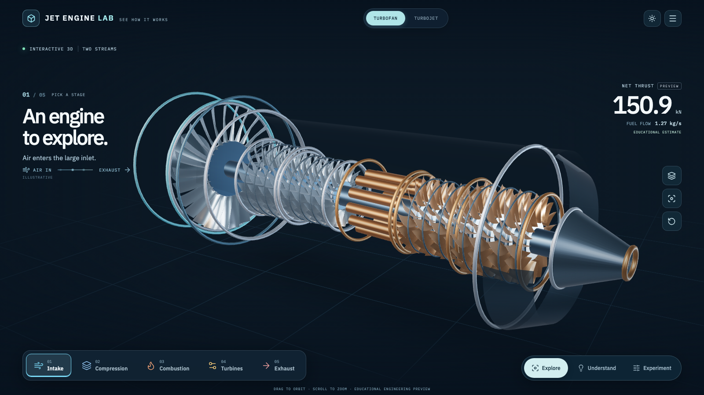
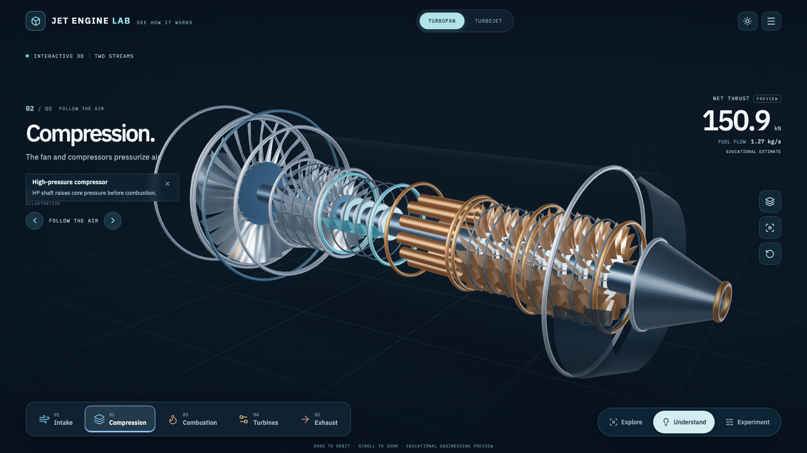
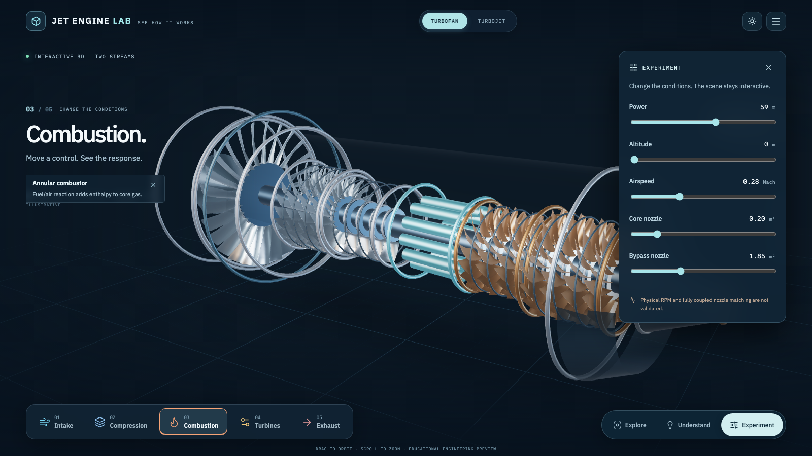
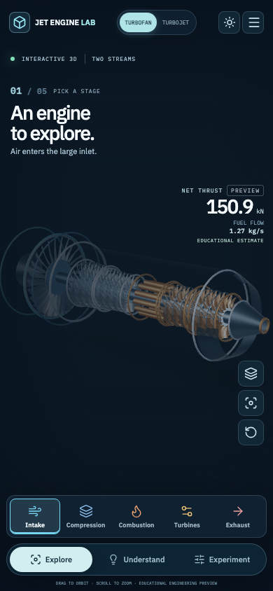

# Jet Engine Lab

**See how a jet engine works. Don't just read about it.**

[**Explore the interactive engine**](https://aungmyokyaw.github.io/jet-engine-lab/) · [How the model works](docs/ENGINEERING.md) · [Project development](CONTRIBUTING.md)

Jet Engine Lab is a free, browser-based, interactive aerospace learning experience. A single, large **3D turbofan or turbojet** sits at the heart of the app. Select engine stages, explore their parts, follow the airflow, and change operating conditions without leaving the scene.

> **Engineering preview:** The 3D model, illustrative airflow and rotor motion teach concepts rather than represent an OEM-validated engine. The numerical cycle solver is preliminary. Calibrated physical N1/N2 RPM and fully coupled off-design nozzle matching are not yet implemented. Do not use its outputs for real engine design or operation.

## See the engine



| Understand the engine | Experiment with the inputs |
|:---:|:---:|
|  |  |

**Mobile experience**



## Three ways to explore

- **Explore** — Rotate and zoom the engine, tap any component, switch between turbofan and turbojet, inspect its structure, hide the casing and toggle exploded view. Only the engine uses interactive 3D; the stage strip and controls use lightweight accessible web UI.
- **Understand** — Follow a five-stage visual journey: **Intake → Compression → Combustion → Turbines → Exhaust**. Each stage highlights a component, with short explanatory captions rather than text-heavy lessons.
- **Experiment** — Change throttle, altitude, Mach and nozzle areas while the preliminary physics worker calculates corresponding outputs. The engine stays visible. On mobile, the Power control comes first and other parameters expand on demand.

The interactive environment offers light/dark themes, one-click camera reset, compact net-thrust and fuel-flow readouts, keyboard-operated stage navigation and a visual-only airflow cue that is labeled **illustrative**. Technical reference material and source maps remain available separately when needed.

## Local development

Use [Bun](https://bun.sh/) and a modern browser:

```bash
bun install --frozen-lockfile
bun run dev
# http://127.0.0.1:4173/#/engines/turbofan
```

### Verify

```bash
bun run docs:check
bun run typecheck
bun run test
bun run build
bun run smoke             # Playwright: visual stage flow, input changes, desktop/mobile
bun run smoke:production  # GitHub Pages preview, 3D loader, Reference, offline shell
```

The visual tests capture six viewport sizes and critical state changes. Production builds use the `/jet-engine-lab/` base path, hash routing and a versioned offline shell. An optional standalone PWA manifest is included.

## Scientific accuracy and limitations

The current `src/app/physics/cycle.ts` performs a simplified, bounded 0D cycle calculation. Visual rotor movement and flow are demonstrations, **not** measured motion or computational fluid dynamics. Component geometry is schematic. Physical RPM remains unavailable because the source-pinned map datasets have not yet been calibrated and coupled to a verified off-design solver.

The five [OpenMDAO pyCycle](https://github.com/OpenMDAO/pyCycle) maps can be inspected in Reference but do not yet drive the live solver. Nozzle effective-area inputs affect the preliminary calculation and visual throat, but full multi-spool/nozzle closure is still unvalidated.

For precise scope and assumptions, consult [Engineering Notes](docs/ENGINEERING.md), [Off-Design Maps and Nozzles](docs/OFF_DESIGN_MAPS_AND_NOZZLES.md), and [Implementation Status](docs/IMPLEMENTATION_STATUS.md). Prior CAD workbench experiments are archived in the repository; this release deliberately uses **one primary interactive 3D engine** and a minimal visual interface.

## Repository

| Location | Purpose |
|---|---|
| `src/app/visual/` | Immersive three-mode learning interface and design |
| `src/app/engine/` | Procedural Three.js/React Three Fiber engine scene |
| `src/app/physics/` | Numerical preview model, reference-map interpolation and worker |
| `src/app/data/` | Engine component hierarchy, station maps and lesson content |
| `src/app/studio/project.ts` | Versioned local experiment file import/export and recovery |
| `scripts/smoke-visual-first.mjs` | Browser interaction and screenshot regression checks |
| `scripts/smoke-production.mjs` | Production/Pages and offline browser checks |
| `public/manifest.webmanifest` | Optional standalone PWA metadata |

The project remains a **static web application**, not a desktop wrapper. `master` contains the source and the `gh-pages` branch contains the built public site. `bun run deploy` publishes only after an explicit release decision.

## Credits and licensing

Original source code is [MIT licensed](LICENSE). Third-party resources retain their respective licenses: the [Innerscene](https://www.innerscene.com/tools/library/3d-parts/turbofan-quarter-cutaway-e0184203) CC0 reference cutaway, [Poly Haven Studio Small 08](https://polyhaven.com/a/studio_small_08) CC0 lighting, [OpenMDAO pyCycle](https://github.com/OpenMDAO/pyCycle) Apache-2.0 map data, and IBM Plex Sans/Mono fonts under the SIL Open Font License. See [Asset Provenance](docs/ASSET_PROVENANCE.md) and the [Credits page](https://aungmyokyaw.github.io/jet-engine-lab/#/credits).

The optional CC0 cutaway is a separate **visual reference** and is not the engine solver mesh. No engine-manufacturer certification or endorsement is implied.
