# Jet Engine Lab

**Five jet engines. Five big ideas. One interactive 3D experience.**

[**Explore the engine collection**](https://aungmyokyaw.github.io/jet-engine-lab/) · [Engineering methods](docs/ENGINEERING.md) · [Development](CONTRIBUTING.md)

Jet Engine Lab is a free, browser-based aerospace learning experience. The engine is the interface: rotate it, tap an assembly, isolate a stage, reveal airflow, and learn what makes each design different. There is no account, desktop installer, or required server.

> **Educational preview, not engineering certification.** Three newly added architectures are **visual-only studies** and intentionally have no fabricated thrust, fuel-flow or RPM outputs. The original turbojet and high-bypass turbofan retain preliminary 0D numerical cycle estimates. No model here is validated for real-engine design, manufacture or operation.

## Inside the interactive 3D lab

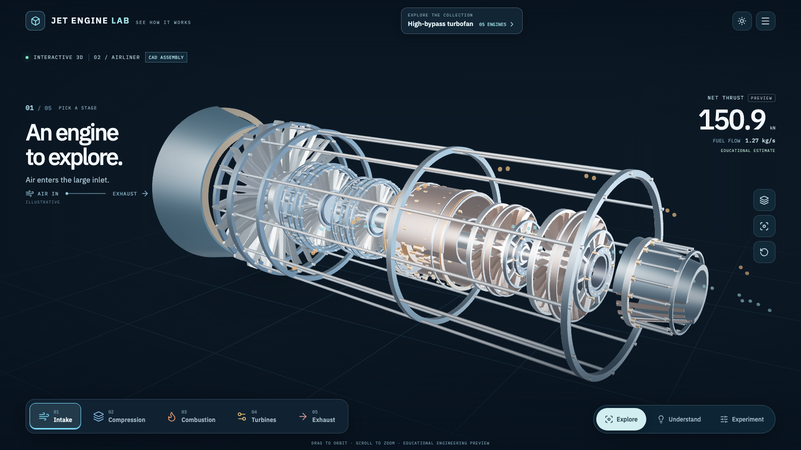

## Five engines to explore

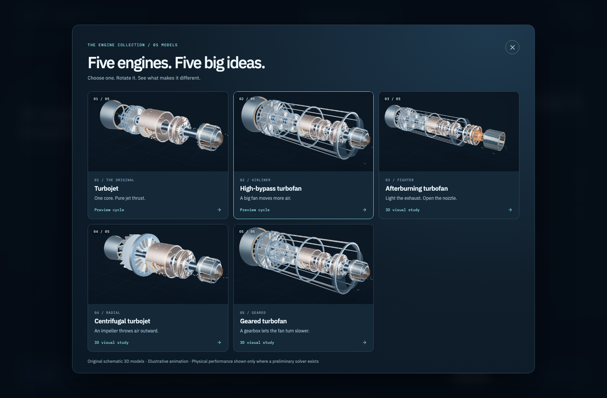

| Engine | One big idea | Model status |
|---|---|---|
| [Turbojet](https://aungmyokyaw.github.io/jet-engine-lab/#/engines/turbojet) | One core produces jet thrust | Preliminary cycle |
| [High-bypass turbofan](https://aungmyokyaw.github.io/jet-engine-lab/#/engines/turbofan) | A big fan moves more air | Preliminary cycle |
| [Afterburning turbofan](https://aungmyokyaw.github.io/jet-engine-lab/#/engines/afterburning-turbofan) | Burn extra fuel downstream; adjust nozzle petals | **3D visual study only** |
| [Centrifugal turbojet](https://aungmyokyaw.github.io/jet-engine-lab/#/engines/centrifugal-turbojet) | A rotating impeller throws air radially outward | **3D visual study only** |
| [Geared turbofan](https://aungmyokyaw.github.io/jet-engine-lab/#/engines/geared-turbofan) | A reduction gearbox allows a slower fan | **3D visual study only** |

Every engine is an **interactive 3D CAD assembly**, not a static image. **32 original SolidCraft B-rep design families** supply the drive shafts, fan, compressor, combustor, turbine, bearings, guide vanes, gearbox and nozzle hardware, including independently authored core and bypass nozzle lips, bypass petals and inner fairing. Every visible mechanical part in the WebGL engine scenes is a model authored with SolidCraft CLI; animated airflow, explanatory power cues and lighting are visual effects. All five gallery cards use renders of the same assembled CAD scenes. The viewer waits for the complete CAD assembly before revealing it. If an original CAD asset fails, the viewer reports the failure with a retry action instead of substituting another engine model.

## Inspect the machinery, not just the shell

The **complete engine** now uses original SolidCraft CAD assets throughout: intake, rotor stages, combustor, turbine, nozzle, bypass structure and architecture-specific impeller, diffuser, afterburner or reduction gearbox. Select any component to inspect the same CAD geometry in isolation, then return to the full engine. These editable designs are educational illustrations, not production-validated engine parts.

| Lofted rotor blades | Annular fuel injectors | Planetary reduction gearbox |
|:---:|:---:|:---:|
| 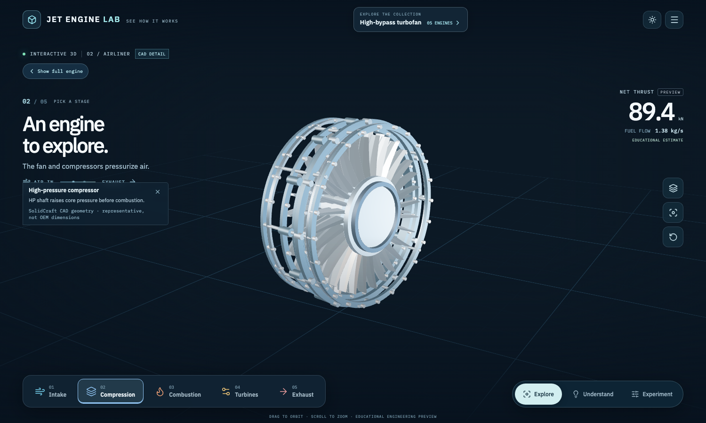 | 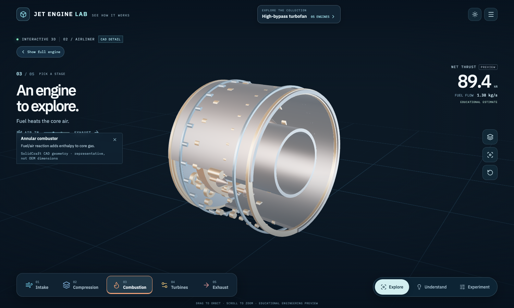 | 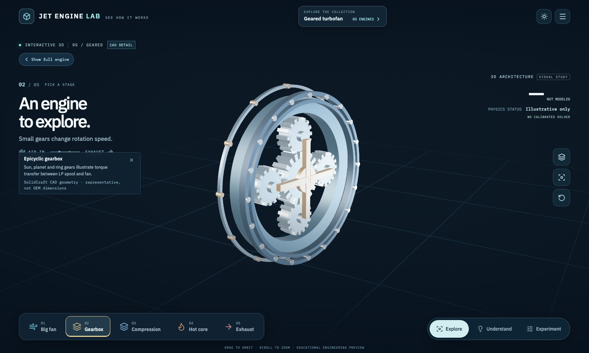 |

The CAD design files, reproducible `solidcraft-cli` commands and browser verification are documented in [SolidCraft component detail](docs/solidcraft-cad/README.md). None of these shapes adds a new engine-performance claim.

| Complete axial turbojet | Complete geared turbofan |
|:---:|:---:|
| 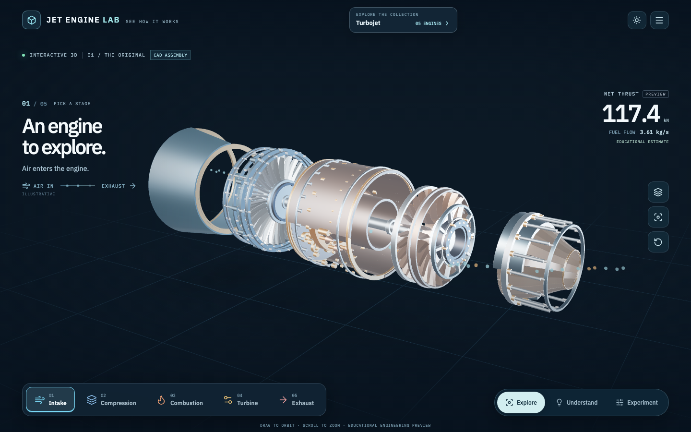 | 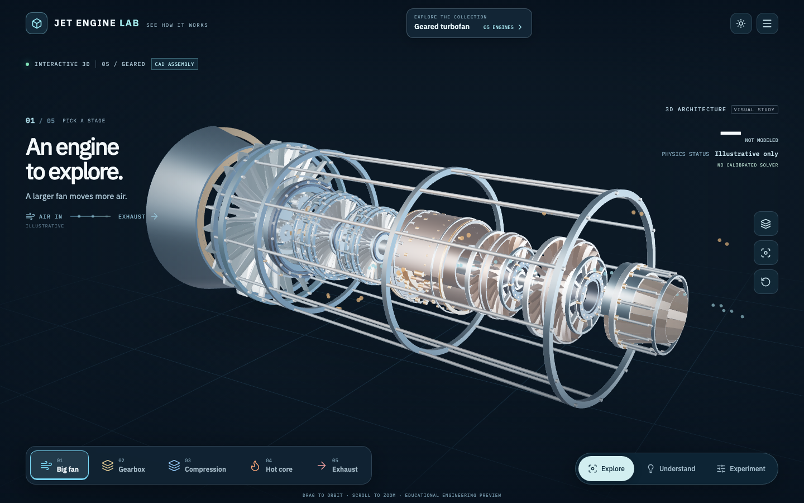 |

Each model can be orbited and exploded, with individual assemblies isolated for close inspection. CAD source timelines (`.json`), editable SolidCraft models (`.sc`) and optimized browser geometry (`.glb`) are all retained in the repository.

## See more; read less

| Afterburner and variable nozzle | Centrifugal compressor impeller | Geared turbofan power path |
|:---:|:---:|:---:|
| 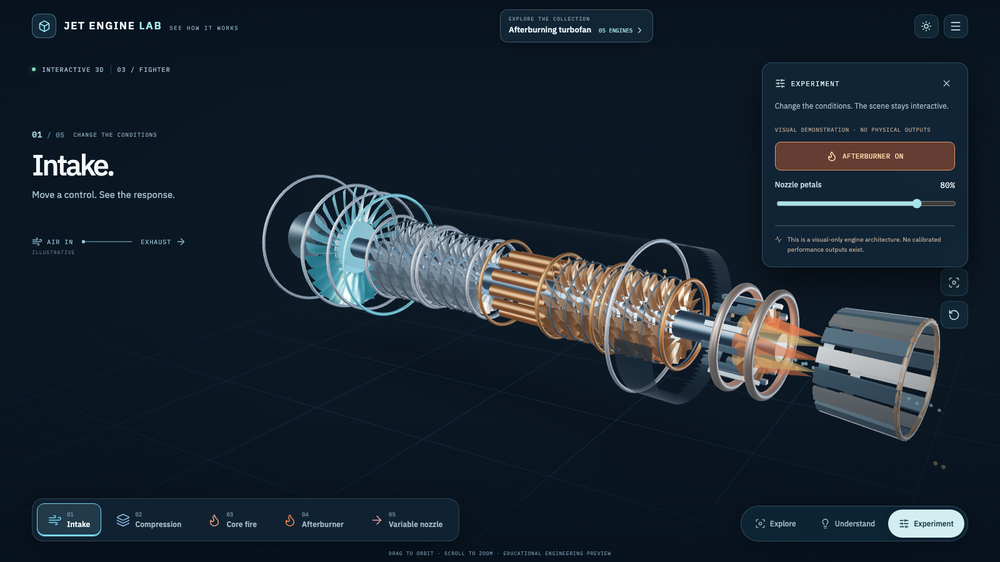 | 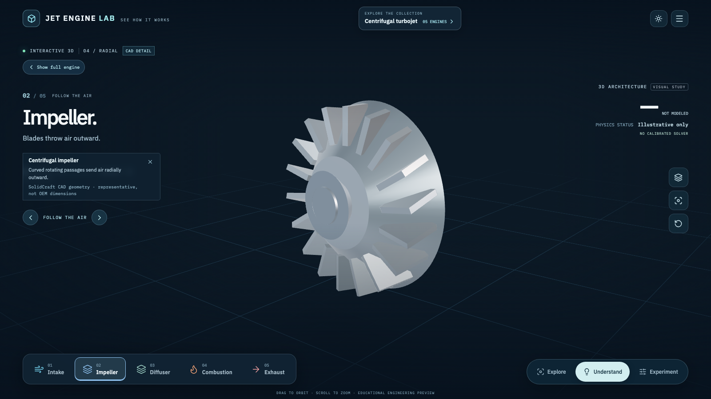 | 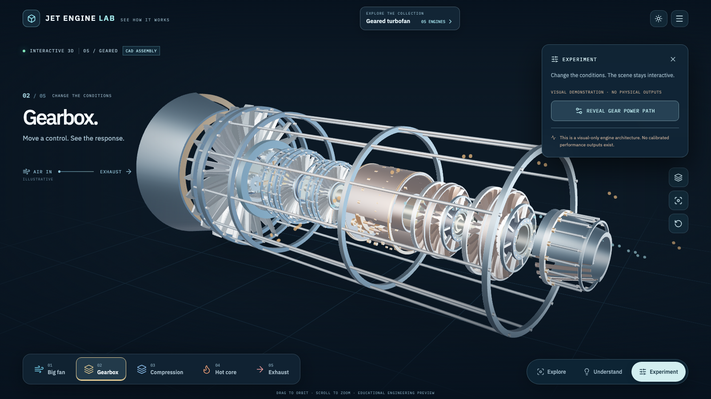 |

| Exploded original CAD assembly | Preliminary force and shaft audit |
|:---:|:---:|
| 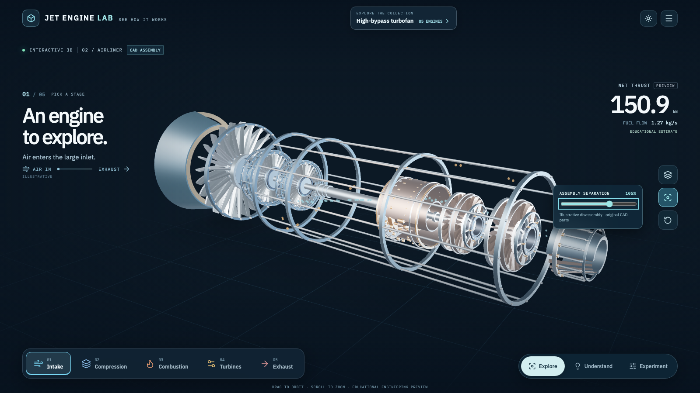 | 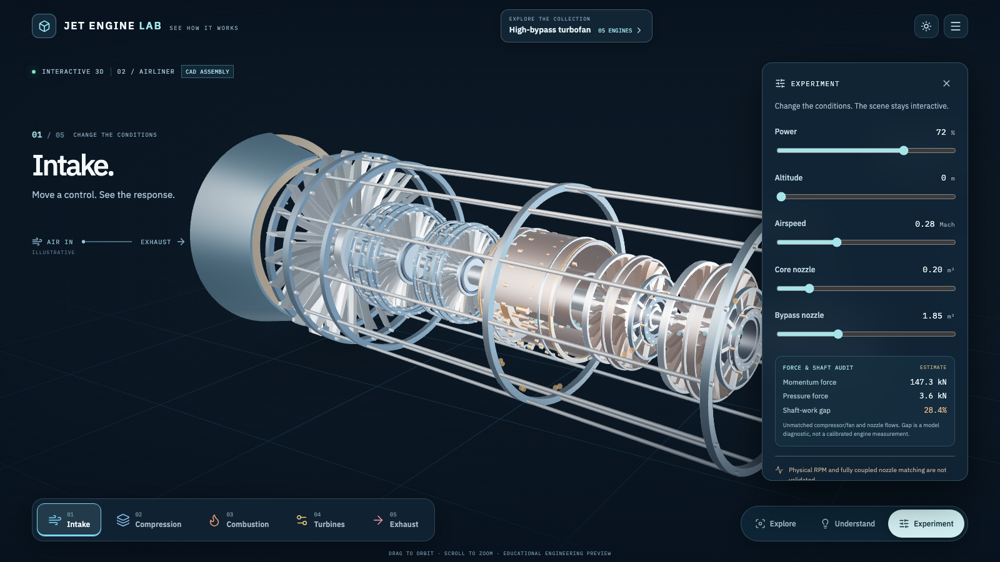 |

### Designed for mobile, too

| Engine workspace | Five-engine collection |
|:---:|:---:|
| 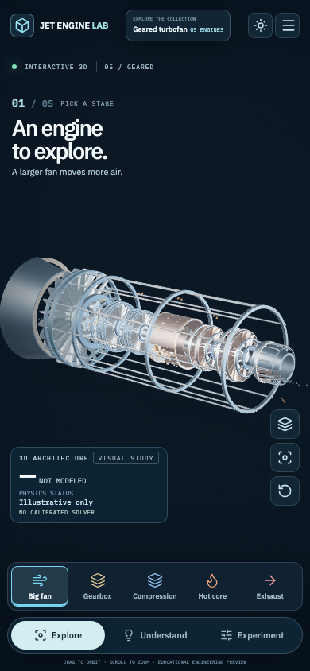 | 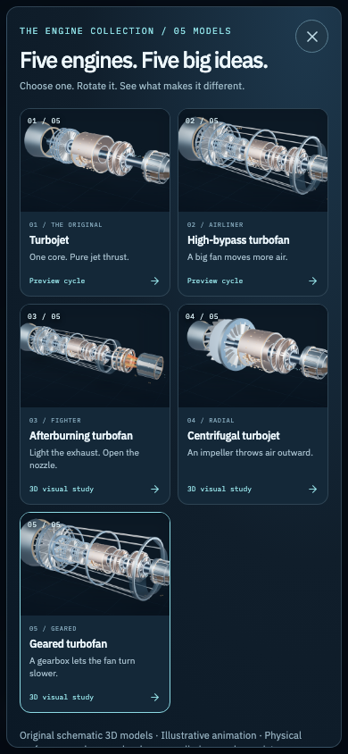 |

The interface keeps three actions: **Explore, Understand, Experiment**.

**Explore** rotates and zooms the engine, switches architectures, selects assemblies, hides casing, explodes parts, and reveals illustrative 3D airflow, heat zones, ghost views and shaft power paths. **Understand** guides you through five visual steps, focusing on one assembly at a time and offering a clear return to the full engine. **Experiment** provides preliminary numerical operating controls and a visible momentum, pressure-force and shaft-work diagnostic only on the two existing solved engines. On visual-only engines, it instead offers architecture-specific demonstrations such as afterburner on/off, nozzle-petal opening, radial impeller inspection and gearbox power-path highlighting.

The 3D models and visual effects are educational illustrations, not aerospace CAD drawings or computational fluid dynamics. Flame, rotation and motion are **not** predictions of real temperatures, speeds, clearances or performance.

## Run locally

Install [Bun](https://bun.sh/) and use a current browser:

```bash
bun install --frozen-lockfile
bun run dev
# Open http://127.0.0.1:5173/#/engines/turbofan
```

### Validate

```bash
bun run docs:check
bun run typecheck
bun run test
bun run build
bun run smoke             # Existing 3D experience plus all five engine-gallery workflows
bun run smoke:cad:full     # All five assemblies, 3D asset responses, screenshots (preview server on :4173)
bun run smoke:cad:reveal   # Entire CAD assembly loads together; missing-part retry tested
bun run smoke:production  # Static production build, missing-asset error and offline shell
```

For maintainers: `bun run previews:engines` regenerates the five gallery card images from the locally running 3D scenes using Playwright. `bun run smoke:engines` checks engine selection, 3D assets, visual-only numeric integrity, focus, afterburner, nozzle and gear interactions, project state and responsive gallery layout.

### Recreate the README screenshots with Playwright CLI

All nine screenshots in `docs/readme/` are captures of the **running 3D WebGL site**, not mockups or stock imagery. The Playwright capture verifies that the original CAD assets load before saving the engine hero, gallery, exploded CAD, solver diagnostics, interactive demonstrations and mobile views. By default the script uses the public deployed site; for local pre-release verification, set `JETLAB_SCREENSHOT_BASE=http://127.0.0.1:4173/` and run the same capture command.

```bash
bunx playwright test scripts/readme-screenshots.spec.ts --workers=1 --reporter=line
```

The automated captures check for visible WebGL, all five loaded gallery thumbnails, specific interactive engine states and responsive mobile layout before saving images.

## Scientific limits

The bounded numerical solver in `src/app/physics/cycle.ts` supports **only turbojet and high-bypass turbofan** preview cycles. The new afterburning, centrifugal and geared engines are separate visual illustrations: their characteristic geometry and motions have been authored for learning but **no validated numerical engine solver exists for those architectures in this application**.

The numerical cycle now matches modeled shaft work to convergent-nozzle mass capacity for its turbojet and turbofan cases. It reports explicit flow split, choke state and multiple mathematical matching branches. Valid solver snapshots also determine the aperture radii of **original SolidCraft core/bypass throat lips and petal tips** by `A_geometric = A_effective / 0.97`; an independent GLB vertex audit checks 12 core and five bypass cases. These are **assumption-based numerical results and hypothetical CAD dimensions**, not measured-engine validation or full actuator/clearance certification. Independently calibrated compressor/turbine operating maps, physical N1/N2 RPM and traceable engine dimensions remain absent. The five [OpenMDAO pyCycle](https://github.com/OpenMDAO/pyCycle) reference maps remain inspectable but are not coupled into the current solver. Run `bun run physics:validate` and `bun run cad:validate` for repeatable internal audits and read the [Digital Twin Evidence and Release Gates](validation/DIGITAL_TWIN_EVIDENCE.md) for missing measured data, then see [Engineering Notes](docs/ENGINEERING.md), [Off-Design Maps & Nozzles](docs/OFF_DESIGN_MAPS_AND_NOZZLES.md), [Implementation Status](docs/IMPLEMENTATION_STATUS.md) and [Engine Collection Release Notes](docs/ENGINE_COLLECTION_RELEASE.md).

## Source layout

| Location | Purpose |
|---|---|
| `src/app/data/catalog.ts` | Five-engine catalogue and solver eligibility |
| `src/app/data/parts.ts` | Individually selectable component hierarchies |
| `src/app/engine/EngineViewport.tsx` | Shared 3D renderer, orbit camera and focus/isolation |
| `src/app/engine/SolidCraftDetail.tsx` | Original SolidCraft mechanical geometry, shaft models and rotor motion |
| `src/app/engine/SpecialGeometry.tsx` | Explanatory lighting and shaft-power overlay only |
| `src/app/engine/EngineFlowParticles.tsx` | Lightweight illustrative 3D core/bypass airflow |
| `src/app/visual/` | Engine gallery, visual learning and minimal interface |
| `src/app/physics/` | Preliminary numeric solver and source-pinned maps |
| `src/app/studio/project.ts` | Backward-compatible local experiment export/import and recovery |
| `scripts/capture-engine-previews.mjs` | Reproducible original-3D gallery images |
| `scripts/smoke-engine-gallery.mjs` | Five-architecture interaction and integrity tests |

The app remains static-hosted on GitHub Pages. Source is maintained on `master`; the published site comes from `gh-pages`.

## License and credits

Jet Engine Lab's original source and SolidCraft CAD models are covered by the repository's [MIT License](LICENSE). External assets retain their own terms, including [Poly Haven Studio Small 08](https://polyhaven.com/a/studio_small_08) lighting (CC0), [OpenMDAO pyCycle](https://github.com/OpenMDAO/pyCycle) map data (Apache-2.0), and IBM Plex fonts (SIL OFL). See [Asset Provenance](docs/ASSET_PROVENANCE.md) and [Credits](https://aungmyokyaw.github.io/jet-engine-lab/#/credits).

No engine-manufacturer endorsement, precise OEM geometry or certified numerical performance is implied.
