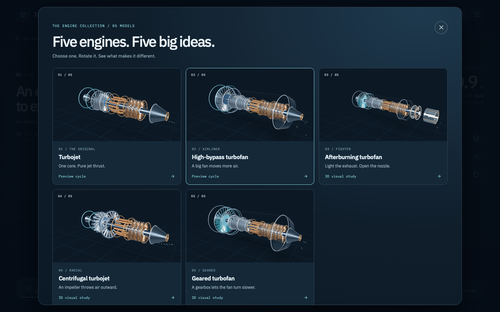
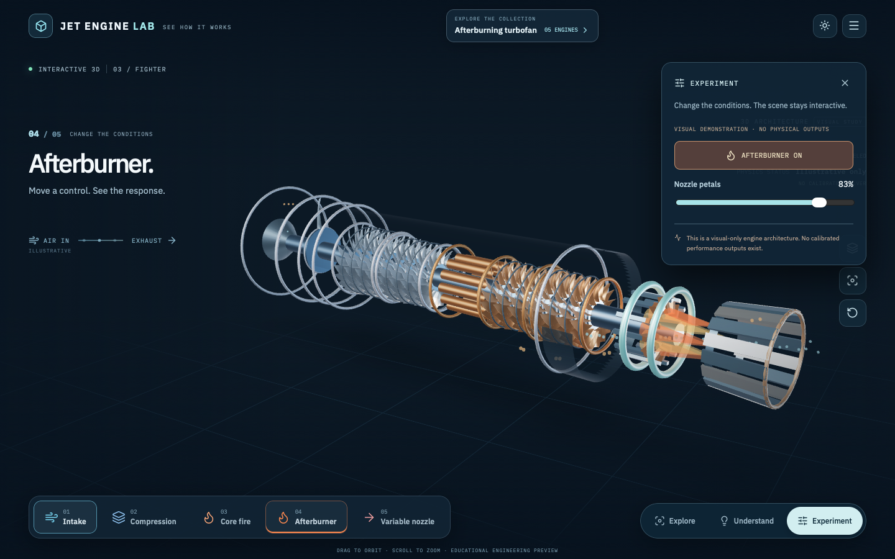
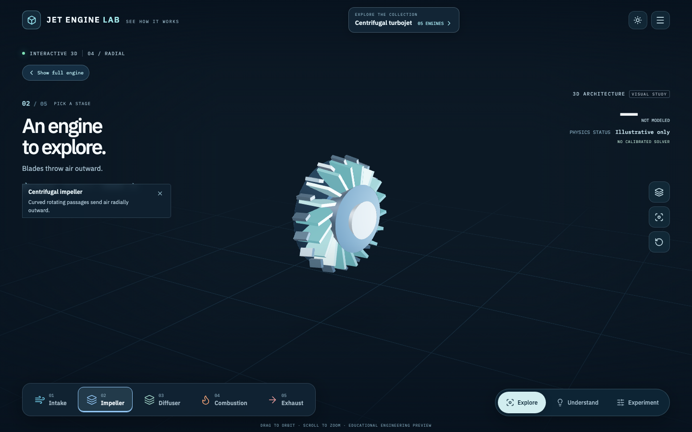

# Jet Engine Lab

**Five jet engines. Five big ideas. One interactive 3D experience.**

[**Explore the engine collection**](https://aungmyokyaw.github.io/jet-engine-lab/) · [Engineering methods](docs/ENGINEERING.md) · [Development](CONTRIBUTING.md)

Jet Engine Lab is a free, browser-based aerospace learning experience. The engine is the interface: rotate it, tap an assembly, isolate a stage, reveal airflow, and learn what makes each design different. There is no account, desktop installer, or required server.

> **Educational preview, not engineering certification.** Three newly added architectures are **visual-only studies** and intentionally have no fabricated thrust, fuel-flow or RPM outputs. The original turbojet and high-bypass turbofan retain preliminary 0D numerical cycle estimates. No model here is validated for real-engine design, manufacture or operation.

## Five engines to explore



| Engine | One big idea | Model status |
|---|---|---|
| [Turbojet](https://aungmyokyaw.github.io/jet-engine-lab/#/engines/turbojet) | One core produces jet thrust | Preliminary cycle |
| [High-bypass turbofan](https://aungmyokyaw.github.io/jet-engine-lab/#/engines/turbofan) | A big fan moves more air | Preliminary cycle |
| [Afterburning turbofan](https://aungmyokyaw.github.io/jet-engine-lab/#/engines/afterburning-turbofan) | Burn extra fuel downstream; adjust nozzle petals | **3D visual study only** |
| [Centrifugal turbojet](https://aungmyokyaw.github.io/jet-engine-lab/#/engines/centrifugal-turbojet) | A rotating impeller throws air radially outward | **3D visual study only** |
| [Geared turbofan](https://aungmyokyaw.github.io/jet-engine-lab/#/engines/geared-turbofan) | A reduction gearbox allows a slower fan | **3D visual study only** |

Every engine is an **interactive procedural 3D model**, not a static image. The gallery cards use screenshots captured from those same scenes, so selecting an engine opens the actual object for inspection.

## See more; read less

| Afterburner demonstration | Radial compressor close-up |
|:---:|:---:|
|  |  |

The interface keeps three actions: **Explore, Understand, Experiment**.

**Explore** rotates and zooms the engine, switches architectures, selects assemblies, hides casing, explodes parts, and reveals illustrative 3D airflow, heat zones, ghost views and shaft power paths. **Understand** guides you through five visual steps, focusing on one assembly at a time and offering a clear return to the full engine. **Experiment** provides preliminary numerical operating controls only on the two existing solved engines. On visual-only engines, it instead offers architecture-specific demonstrations such as afterburner on/off, nozzle-petal opening, radial impeller inspection and gearbox power-path highlighting.

The 3D models and visual effects are educational illustrations, not aerospace CAD drawings or computational fluid dynamics. Flame, rotation and motion are **not** predictions of real temperatures, speeds, clearances or performance.

## Run locally

Install [Bun](https://bun.sh/) and use a current browser:

```bash
bun install --frozen-lockfile
bun run dev
# Open http://127.0.0.1:4173/#/engines/turbofan
```

### Validate

```bash
bun run docs:check
bun run typecheck
bun run test
bun run build
bun run smoke             # Existing 3D experience plus all five engine-gallery workflows
bun run smoke:production  # Static production build, reference and offline shell
```

For maintainers: `bun run previews:engines` regenerates the five gallery images from the locally running 3D scenes using Playwright. `bun run smoke:engines` checks engine selection, 3D assets, visual-only numeric integrity, focus, afterburner, nozzle and gear interactions, project state and responsive gallery layout.

## Scientific limits

The bounded numerical solver in `src/app/physics/cycle.ts` supports **only turbojet and high-bypass turbofan** preview cycles. The new afterburning, centrifugal and geared engines are separate visual illustrations: their characteristic geometry and motions have been authored for learning but **no validated numerical engine solver exists for those architectures in this application**.

The numerical cycle does not yet include independently calibrated compressor/turbine map matching, physical N1/N2 RPM or fully coupled off-design nozzle/shaft closure. The five [OpenMDAO pyCycle](https://github.com/OpenMDAO/pyCycle) reference maps remain inspectable but are not coupled into the current solver. Consult [Engineering Notes](docs/ENGINEERING.md), [Off-Design Maps & Nozzles](docs/OFF_DESIGN_MAPS_AND_NOZZLES.md), [Implementation Status](docs/IMPLEMENTATION_STATUS.md) and [Engine Collection Release Notes](docs/ENGINE_COLLECTION_RELEASE.md).

## Source layout

| Location | Purpose |
|---|---|
| `src/app/data/catalog.ts` | Five-engine catalogue and solver eligibility |
| `src/app/data/parts.ts` | Individually selectable component hierarchies |
| `src/app/engine/EngineViewport.tsx` | Shared 3D renderer, orbit camera and focus/isolation |
| `src/app/engine/SpecialGeometry.tsx` | Afterburner, nozzle petals, radial impeller/diffuser and planetary gearbox |
| `src/app/engine/EngineFlowParticles.tsx` | Lightweight illustrative 3D core/bypass airflow |
| `src/app/visual/` | Engine gallery, visual learning and minimal interface |
| `src/app/physics/` | Preliminary numeric solver and source-pinned maps |
| `src/app/studio/project.ts` | Backward-compatible local experiment export/import and recovery |
| `scripts/capture-engine-previews.mjs` | Reproducible original-3D gallery images |
| `scripts/smoke-engine-gallery.mjs` | Five-architecture interaction and integrity tests |

The app remains static-hosted on GitHub Pages. Source is maintained on `master`; the published site comes from `gh-pages`.

## License and credits

Jet Engine Lab's original source and procedural engine geometry are covered by the repository's [MIT License](LICENSE). External assets retain their own terms, including [Innerscene's](https://www.innerscene.com/tools/library/3d-parts/turbofan-quarter-cutaway-e0184203) optional CC0 cutaway, [Poly Haven Studio Small 08](https://polyhaven.com/a/studio_small_08) lighting (CC0), [OpenMDAO pyCycle](https://github.com/OpenMDAO/pyCycle) map data (Apache-2.0), and IBM Plex fonts (SIL OFL). See [Asset Provenance](docs/ASSET_PROVENANCE.md) and [Credits](https://aungmyokyaw.github.io/jet-engine-lab/#/credits).

No engine-manufacturer endorsement, precise OEM geometry or certified numerical performance is implied.
