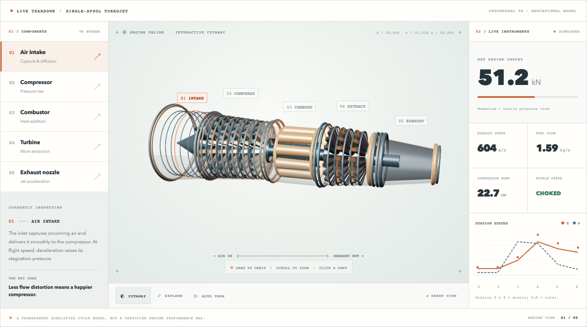

# Jet Engine Lab

A jet engine makes more sense when you can open it up.

Jet Engine Lab is a small, interactive explanation of a single-spool turbojet. Rotate the engine, expose the compressor and turbine, and follow the airflow from inlet to nozzle. The instruments are connected to a simplified thermodynamic model, so changing a setting changes the station pressures, temperatures, fuel flow, and thrust—not just the animation.



**Try it:** Open the live demo from this repository's **About → Website** link.

## Explore the engine

The 3D model has five selectable sections: intake, axial compressor, combustor, turbine, and exhaust nozzle. Drag to orbit, scroll to zoom, and use **Cutaway**, **Explode**, or **Auto tour** to look inside.

Below the model, five controls let you change throttle, compressor pressure ratio, air mass flow, altitude, and flight Mach number. Two graphs trace the calculated temperature and pressure through six stations. You can also study an airfoil at different angles of attack, explore rotor-relative velocity triangles, and work through a short self-check.

The model is intentionally a **turbojet**, not a modern high-bypass turbofan. There is no bypass stream or second spool to hide the basic energy flow.

## Run locally

[Bun](https://bun.sh/) and a browser with WebGL support are all you need. No dependency installation, account, or API key is required.

```sh
# Clone this repository using GitHub's Code menu, then:
cd jet-engine-lab
bun run dev
```

Open **http://127.0.0.1:4173**.

For a static production build:

```sh
bun test
bun run build
bun run preview
```

The finished site is in `dist/`. You can serve that directory with any static file host. Three.js is vendored so the simulation also runs without a network connection once the files are available.

## Publish updates

GitHub Pages serves the separate `gh-pages` branch. After editing the site, run:

```sh
bun run deploy
```

This tests the calculations, rebuilds the static files, and publishes the updated output to `gh-pages`. It requires push access to the repository, but does not need a GitHub Actions workflow token. Source changes belong on `master`; the deployment branch contains only the built site.

## Record the complete website

The recording script captures a 1600 × 900 browser viewport from the page header through the footer. It inspects each engine stage, changes the live controls, visits the airfoil and rotor-velocity laboratories, shows the cycle analysis and knowledge check, and finishes with an overlapping top-to-bottom coverage pass. The recording is converted to an H.264 MP4 using FFmpeg.

Install the optional recording dependency once:

```sh
bun add --dev playwright
```

Then use the published site's URL or a local production preview:

```sh
RECORD_URL="https://your-account.github.io/jet-engine-lab/" bun run record
```

The MP4, sample frames and a timestamped coverage report are written to `recordings/` (Git-ignored). The report records visible sections and browser errors. Recording requires Playwright's Chromium and FFmpeg; the interactive website itself doesn't require either. The video is intentionally silent.

## How it's organized

| File | Role |
| --- | --- |
| `src/scene.js` | Procedural 3D model, camera, animation, cutaway and component interaction |
| `src/physics.js` | Atmosphere, turbojet station states, thrust, airfoil model and velocity triangle |
| `src/main.js` | Controls, charts, lessons and instrument readouts |
| `src/physics.test.js` | Calculation tests and representative operating points |
| `src/build.js` | Dependency-free Bun static bundler |
| `src/server.js` | Minimal local development/preview server |
| `docs/ENGINEERING.md` | Equations, assumptions, references and known limits |

## What the numbers mean

This is a **steady-state, zero-dimensional teaching model**. Component efficiencies and gas properties are fixed, the atmosphere follows an ISA approximation, and the nozzle uses an idealized convergent-flow calculation. The compressor, burner, turbine, and nozzle obey the same energy and momentum balances that drive the instruments.

It's useful for answering questions such as “why does compressor work rise with pressure ratio?” and “where does the turbine's power go?” It isn't a compressor map, CFD solver, control-system model, or a substitute for engine design data. The rotor blades are illustrative rather than dimensioned replicas.

See [Engineering notes](docs/ENGINEERING.md) for every major assumption and equation.

## Sources and credits

The explanations follow the introductory gas-turbine material from [NASA Glenn](https://www1.grc.nasa.gov/beginners-guide-to-aeronautics/turbine-engines/), including its [Brayton-cycle](https://www.grc.nasa.gov/www/k-12/BGP/brayton.html) and [axial-compressor](https://www.grc.nasa.gov/www/k-12/airplane/caxial.html) introductions. The [FAA's engine familiarization guide](https://www.faa.gov/sites/faa.gov/files/aircraft/air_cert/design_approvals/engine_prop/engine_malf_famil.pdf) provides useful operational context.

Rendered with [Three.js](https://threejs.org/), distributed under its own MIT license in `src/vendor/LICENSE.three.js`. The project source is MIT-licensed; see [LICENSE](LICENSE).
