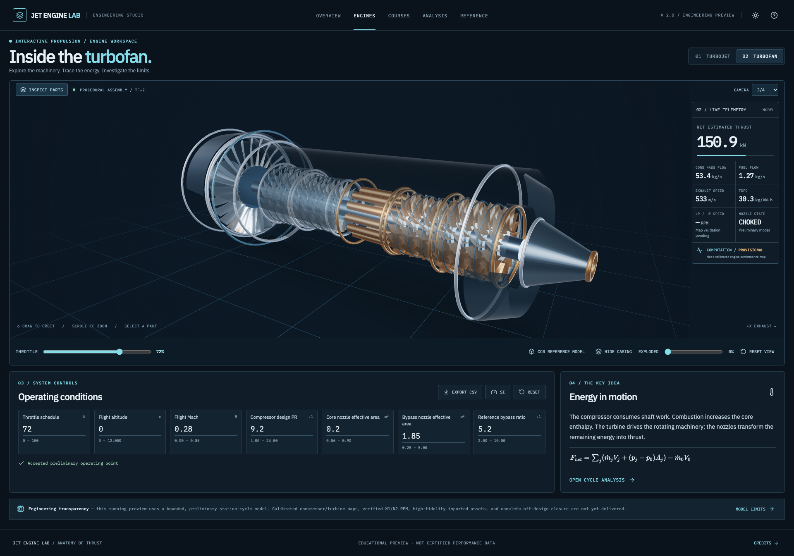
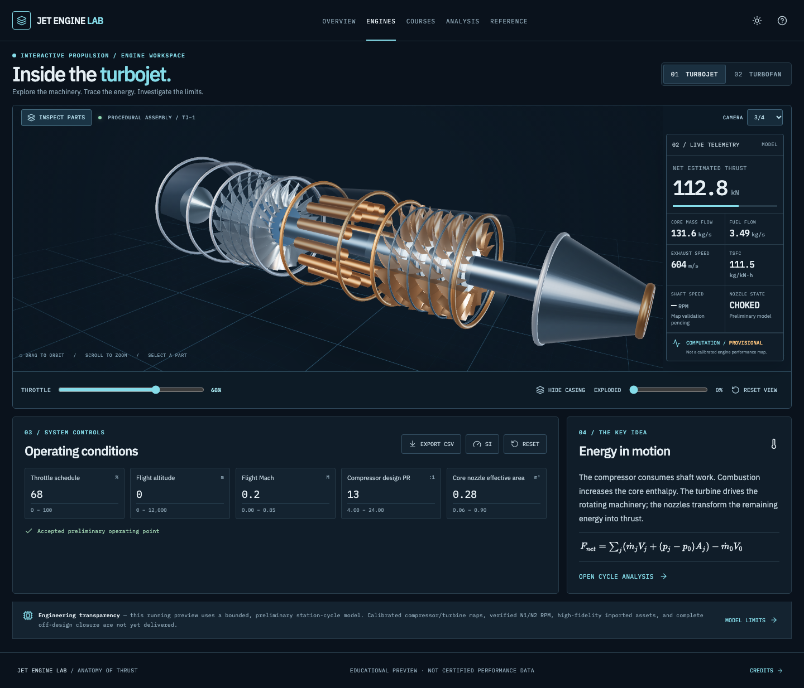
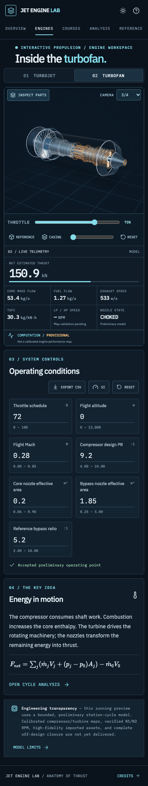

# Jet Engine Lab

**Explore how turbojets and turbofans work—from rotating assemblies to the thermodynamic cycle.**

[**Launch the interactive lab**](https://aungmyokyaw.github.io/jet-engine-lab/) · [Engineering model](docs/ENGINEERING.md) · [Contributing](CONTRIBUTING.md)

Jet Engine Lab is a free, browser-based engineering learning project. Inspect two distinct jet-engine architectures in 3D, adjust operating conditions, explore station pressure and temperature, and study the mechanics of thrust. Built with **React 19, TypeScript, Three.js, React Three Fiber and Bun**.

> **Scientific status: educational preview.** The current solver is a preliminary steady-state approximation—not a calibrated off-design engine-performance model. Absolute shaft RPM (N1/N2) is deliberately unavailable. Results must not be used to design, operate or certify real engines. The live website is published, but scientific acceptance is still incomplete.

## Screenshots

**Turbofan — desktop engineering workspace**



| Turbojet — desktop | Turbofan — mobile |
|:---:|:---:|
|  |  |

[See the full before-and-after visual audit](docs/visual-audit/REVIEW.md), including the mobile component inspector, light theme and fully exploded assemblies.

## Explore the lab

- **Engines:** Separate single-spool turbojet and two-spool, separate-flow turbofan models. Orbit, zoom, inspect assemblies, toggle the casing, explode parts and select camera presets. The workspace uses adaptive framing, a contextual component inspector, compact telemetry and a quick throttle.
- **Operating conditions:** Change throttle, altitude, Mach number, compressor design pressure ratio and effective nozzle area. The turbofan also exposes bypass-ratio and independent bypass-nozzle controls. Invalid input is rejected; the previous accepted result remains visible.
- **Analysis:** Review approximate station temperatures and pressures, thrust, fuel flow, flow split and fuel consumption. Export station data as CSV and inspect both engine types side by side. **The baseline engines have different design assumptions; this is not a calibrated, matched-condition performance comparison.**
- **Courses:** Fifteen introductory learning topics with explanations, experiment prompts and self-check questions. Reviewed-state progress stays in your browser. These are **outlines**, not yet the complete validated engineering course.
- **Reference:** Equations, assumptions, source links and a map explorer with five source-pinned [OpenMDAO pyCycle](https://github.com/OpenMDAO/pyCycle) compressor/turbine reference datasets. These maps are inspectable but **not yet coupled to the engine solver**.
- **Accessibility and mobile:** Responsive layouts, keyboard-operated controls, reduced-motion support and a labeled 2D schematic when WebGL is unavailable. Full accessibility acceptance remains outstanding.

The optional, independently credited [Innerscene CC0 turbofan cutaway](https://www.innerscene.com/tools/library/3d-parts/turbofan-quarter-cutaway-e0184203) is a **visual reference**, not the mechanically complete solver geometry.

## Run locally

Requires [Bun](https://bun.sh/) and a modern browser. Install Playwright browser binaries if you want to run the browser checks.

```bash
bun install --frozen-lockfile
bun run dev
# Open http://127.0.0.1:4173/#/engines/turbofan
```

### Verify a change

```bash
bun run docs:check       # Markdown links and accidental tool-output metadata
bun run typecheck
bun run test
bun run build
bun run smoke             # Chromium routes and interactions
bun run smoke:visual      # Six responsive viewport checks
bun run smoke:production  # GitHub Pages-style build and offline check
```

`bun run build` generates `dist/` with a `/jet-engine-lab/` base path and a versioned offline shell. `bun run preview` serves the production build. Hash routing makes the static site compatible with GitHub Pages.

**Publishing:** `master` is the source branch. The site is served from `gh-pages` using `bun run deploy`, which rebuilds, tests and pushes the static distribution. Build, test and preview commands do not deploy. See [Contributing](CONTRIBUTING.md) before changing the release process.

## Implementation map

| Path | What it owns |
|---|---|
| `src/app/ui/` | React application, navigation, workspace and styles |
| `src/app/engine/` | Three.js / React Three Fiber engine scenes and optional reference cutaway |
| `src/app/physics/cycle.ts` | Preliminary station-cycle calculations and input validation |
| `src/app/physics/maps.ts` | Bounded reference-map interpolation; **not** a coupled off-design solver |
| `src/app/physics/worker.ts` | Versioned calculations off the main UI thread |
| `src/app/data/` | Component registry, course outlines and source-pinned map tables |
| `src/app/components/MapExplorer.tsx` | Technical reference-map viewer |
| `scripts/import-pycycle-maps.py` | Reproducible, pinned map-table extraction |
| `scripts/smoke-*.mjs`, `scripts/verify-visual-workspace.mjs` | Browser, responsive and production checks |
| `src/physics.js`, `src/scene.js` | Preserved **legacy** turbojet implementation; not the current React application |

## What is not yet validated

1. **D01 — Actual off-design RPM:** calibrated compressor/turbine maps, coupled compressor/flow/spool matching and independently verified physical N1/N2 RPM. Numerical RPM remains unavailable instead of being fabricated.
2. **D02 — Fully coupled variable-area nozzles:** the preview demonstrates effective-area controls and corresponding geometry, but does not yet solve the complete map/nozzle/shaft operating point.
3. **Mechanical fidelity:** detailed verified dimensions, bearings, shaft clearances, sectioning, high-detail LODs and complete explosion/geometry acceptance.
4. **Teaching and release:** full-length assessed chapters, complete screen-reader and multi-browser verification, measured performance, and an independently reviewed numerical reference suite.

Track the precise state in [Implementation Status](docs/IMPLEMENTATION_STATUS.md). The approved long-term requirements live in [PRODUCT.md](PRODUCT.md) and [DESIGN.md](DESIGN.md); they are **targets**, not declarations that every feature is complete. The scientific acceptance gates are in [Physics Spec](docs/PHYSICS_SPEC.md), [Off-Design Maps & Nozzles](docs/OFF_DESIGN_MAPS_AND_NOZZLES.md) and [Verification & Release](docs/VERIFICATION_RELEASE.md).

## Credits and licensing

Jet Engine Lab's original source is released under the [MIT License](LICENSE). Third-party material retains its own terms:

- **Studio Small 08 HDRI** — Sergej Majboroda / [Poly Haven](https://polyhaven.com/a/studio_small_08), CC0.
- **Optional turbofan cutaway** — [Innerscene](https://www.innerscene.com/tools/library/3d-parts/turbofan-quarter-cutaway-e0184203), CC0; illustrative only.
- **Reference component maps** — [OpenMDAO pyCycle](https://github.com/OpenMDAO/pyCycle), Apache-2.0; source commit and hashes recorded with the datasets.
- **IBM Plex Sans / IBM Plex Mono** — SIL Open Font License; self-hosted using Fontsource.

See the [asset provenance register](docs/ASSET_PROVENANCE.md) and [public Credits page](https://aungmyokyaw.github.io/jet-engine-lab/#/credits). The included datasets and visual references do not imply endorsement by any manufacturer or validation of real-engine performance.
