# SolidCraft CAD — Full-Engine Integration

**Implementation:** 2026-11-02, expanded 2026-11-05. The full-engine scenes of all five engine architectures use SolidCraft-originated component geometry exclusively, and focused views reuse the same CAD assets. A failed asset load displays a CAD error and never swaps in procedural or third-party substitute geometry.

## Assembly coverage

| Original SolidCraft design | Categories in assembled scene | Geometry |
|---|---|---|
| `fan-blisk` | fan | Distinct swept wide-chord fan, tapered lofted blades, spinner, labyrinth seal and bolt ring |
| `compressor-cassette` | axial compressor (rotating) | Two differently sized/twisted compressor blade rows, multistage spool and labyrinth seals |
| `stator-vane-ring` | axial compressor (stationary) | Stationary guide vanes, outer casing, hub support and patterned pitch bosses |
| `turbine-wheel` | turbine (rotating) | Distinct turbine bucket profiles, rotor disk, hub shaft and retention hardware |
| `turbine-shroud` | turbine (stationary) | Thermal shroud and forward mounting flange, independent from rotating turbine rotor |
| `combustor-liner` | burner | Dual concentric annular liners, cutaway casing, mounting flanges, cooling and dilution collar patterns |
| `combustor-manifold` | burner (supplement) | Annular fuel manifold, 12 injectors, collars and atomizer tips |
| `planetary-reducer` | gearbox | Four planetary wheels, teeth, carrier, sun gear and annular housing |
| `intake-duct` | inlet | Cutaway converging annular intake housing and flanges |
| `bypass-lattice` | bypass | Longitudinal supports and annular structural frames |
| `nozzle-housing` | nozzle | Cutaway converging support housing |
| `nozzle-actuators` | nozzle (supplement) | Anchor ring, synchronization ring, 16 actuator rods, pistons and end pins |
| `fan-outlet-guides` | fan (stationary supplement) | Annular outlet casing, 24 lofted guide vanes, inner hub, mounting bolts |
| `compressor-case-detail` | axial compressor (stationary supplement) | Three reinforcing ribs, case tie rods, studs, bleed manifold and bosses |
| `turbine-nozzle-guide` | turbine (stationary supplement) | 26 lofted inlet guide vanes, retention details and concentric mounting rings |
| `bearing-cartridge` | turbine (stationary supplement) | Bearing races, seals, housing, support spider and attachment bolts |
| `combustor-dome` | burner (stationary supplement) | Annular dome, 12 bored swirler cups, fuel cones and mounting hardware |
| `nozzle-petals` | nozzle (stationary supplement) | 20 lofted convergent nozzle petals with root hinge elements |
| `core-throat-lip` | nozzle (metering throat) | Circular core nozzle lip with vertex-verified bore |
| `bypass-throat-lip` | bypass nozzle (metering throat) | Annular bypass nozzle lip with independently controlled bore |
| `bypass-nozzle-petals` | bypass nozzle (movable supplement) | Separate convergent bypass petal segments driven by accepted nozzle geometry |
| `bypass-inner-fairing` | bypass nozzle (stationary centerbody) | Annular inner-fairing geometry defining bypass flow annulus |
| `radial-impeller` | impeller | Centrifugal disk with patterned radial vanes |
| `radial-diffuser` | diffuser | Diffuser shroud with stationary guide vanes |
| `afterburner-assembly` | afterburner | Annular flameholders, spray bars and injector tips |
| `shaft-single-spool` | turbojet and centrifugal turbojet | Hollow central drive tube, coupling rings and concentric bearing collars |
| `shaft-dual-spool` | turbofan, afterburning turbofan and geared turbofan | Coaxial HP/LP drive tubes, coupling flanges and bearing rings |
| `bearing-roller-train` | turbine (stationary supplement) | Separate bearing retention hardware with 28 patterned rollers |
| `compressor-service-hardware` | axial compressor (stationary supplement) | Additional exterior support, service bosses and fasteners |
| `combustor-thermal-hardware` | burner (stationary supplement) | Combustor thermal-protection and retention features |
| `gearbox-support-hardware` | gearbox (stationary supplement) | Gearbox support mounts and service hardware |

All **31 active B-rep design families** were generated with **SolidCraft CLI**, each retained as a reproducible `.json` command timeline and editable `.sc` model in `assets/solidcraft/`. Blender converts the exported OBJ files into web `.glb` meshes with physically based materials; originals remain independently editable. The superseded general-purpose `rotor-stage` was removed from the source and website because no assembled engine used it.

All **11 component categories** across the five engine configurations have a SolidCraft CAD source. Rotating fan, compressor and turbine geometry is now distinct, while guide vanes and turbine shrouds stay stationary as the shaft rotates. A given design family is scaled across configurations according to the illustration's part hierarchy. Individual HP/LP spools can still share a family geometry. Realistic detail here means a more complete **visual and interactive engineering study**; dimensions, airfoils, materials, cooling passage topology and performance predictions have **not** been validated against any measured aircraft engine.

## Viewer integration

- The *assembled* view loads the CAD mesh for each part by default. The selected component is independently pickable through its enclosing part group.
- The five-stage journey highlights **the same mounted CAD geometry in the same assembly coordinates**; every original part and drive shaft remains present. Relevant part families stay opaque, while surrounding parts become translucent context. **Show full engine** restores the assembled model without remounting its parts.
- The 25 learning stages across all five architectures cover the assembled parts, including LP/HP compressors and turbines, ducts, gearbox and afterburner.
- Exploded separation is adjustable in the interactive scene from 0% to 160% of representative assembly displacement.
- Three.js caches each distinct GLB per session. Each scene placement clones the loaded scene while sharing geometry/material resources.
- Converter output batches original CAD bodies into about 1–4 web render meshes per source, greatly reducing the draw calls for repeated compressor stages.
- Fan, compressor, turbine and centrifugal impeller animate as grouped original CAD rotors (respecting reduced-motion), with qualitative throttle response rather than measured RPM. Stator rows, turbine shrouds, combustor liner and bearings remain fixed. For the turbojet and turbofan, original SolidCraft nozzle lips and petal meshes are deformed from the **last accepted** cycle result's geometric throat radius, checked against exported GLB vertex data by `cad:validate`. Visual-only engine nozzle movement remains illustrative; neither case verifies an engineered actuator linkage or measured engine geometry.
- Heat lighting, flow markers and shaft-power highlighting are procedural explanatory overlays, with no physical substitute meshes. Casing visibility hides the named casing bodies in the CAD files; individual parts remain pickable.
- CAD assets load through React Suspense. Load errors produce an explicit `CAD ASSET UNAVAILABLE` status; the renderer does not silently use a placeholder or downloaded engine model.
- The former optional CC0 reference engine viewer and its downloaded GLB have been removed from the runtime.

**Engineering limits:** All original SolidCraft CAD is illustrative, not production-certified, OEM-measured, CFD, aeroelastic analysis or material engineering. It is **digital-twin inspired**, but does not meet the definition of a calibrated, sensor-linked engineering digital twin. Design-point/physical RPM/nozzle model calibration remain independent scientific release gates.

## Reproduction

From the Jet Engine Lab project root:

```bash
bun run cad:generate       # solidcraft-cli -> 31 .sc designs + OBJ intermediates -> 31 .glb files
bun run cad:validate       # verify bounded GLB aperture geometry against modeled throat areas
bun run build
bun run smoke:cad:sync     # verify all 25 lessons highlight parts in the original assembly
bun run dev                # or preview on port 4173
bun run smoke:cad          # focus mode + mobile
bun run smoke:cad:full     # all five complete CAD scenes, real asset requests, screenshots
bun run previews:engines   # recapture and crop all five gallery images from assembled CAD scenes
```

`cad:generate` requires `solidcraft-cli` and Blender. Preview cropping requires Python Pillow. OBJ intermediates and SolidCraft backup files are ignored by Git; the source timelines, editable SolidCraft containers and GLBs are retained. The expanded families include specialized rotor, stator, liner, casing, bearing, combustor dome, nozzle, actuator and coaxial shaft details.

## Full-engine evidence

| Turbojet | High-bypass turbofan |
|:---:|:---:|
| 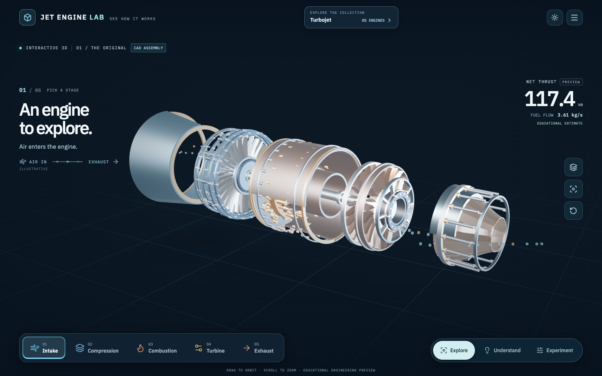 | 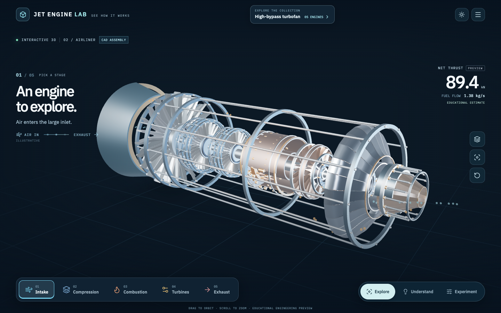 |

| Afterburning turbofan | Centrifugal turbojet | Geared turbofan |
|:---:|:---:|:---:|
| 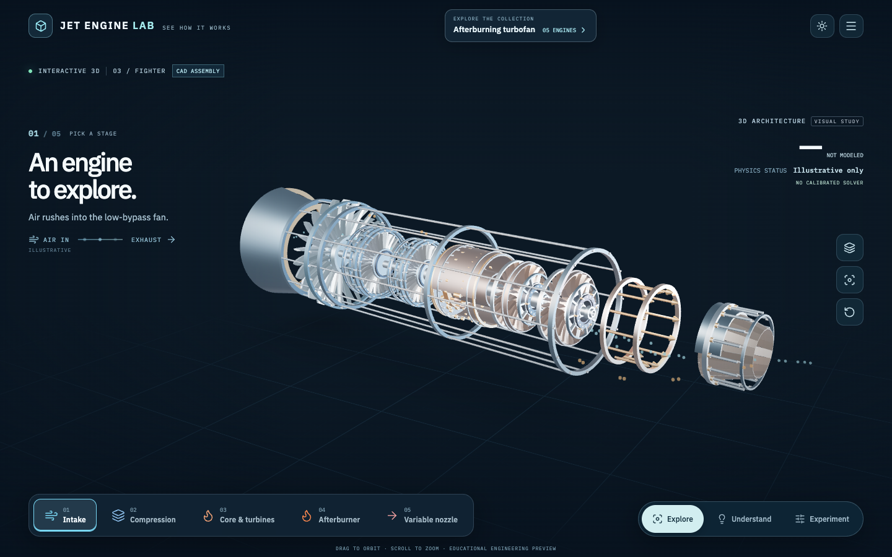 | 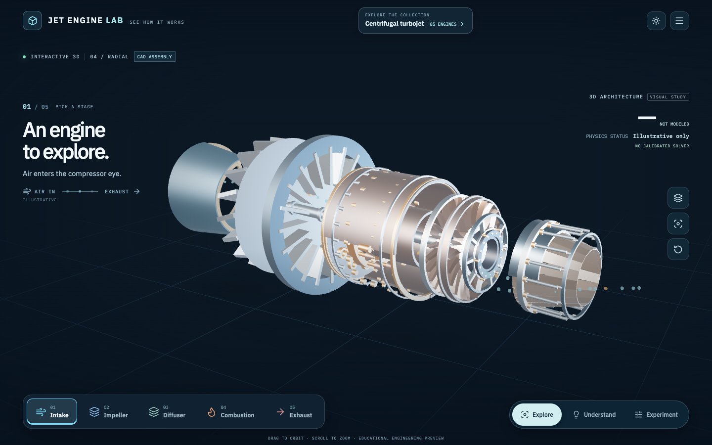 | 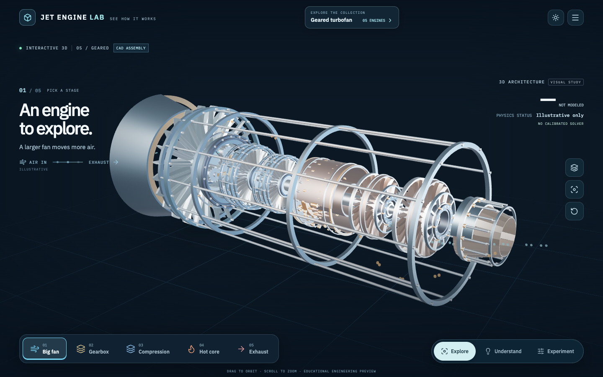 |

## Detail evidence

| Compressor rotor and stator | Annular combustor liner and manifold | Reduction gearbox |
|:---:|:---:|:---:|
| 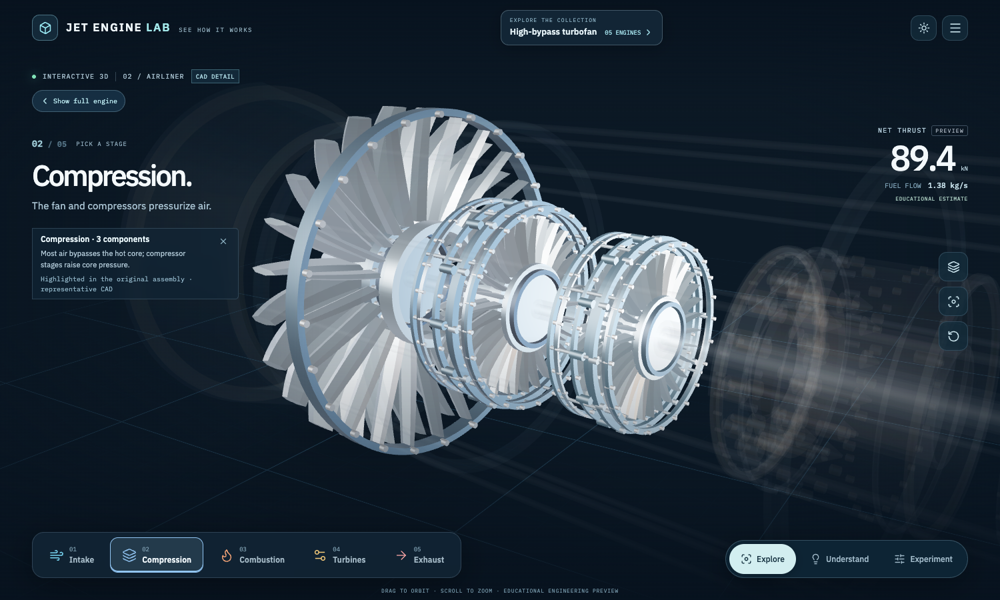 | 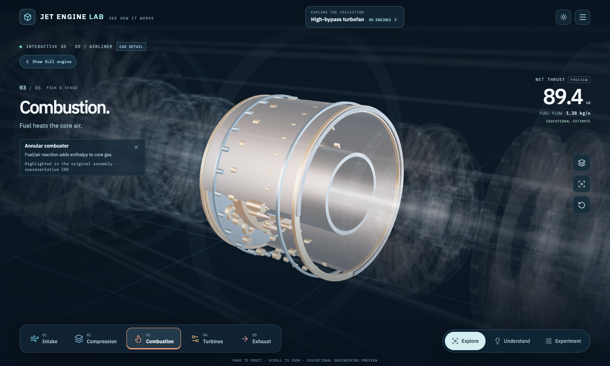 | 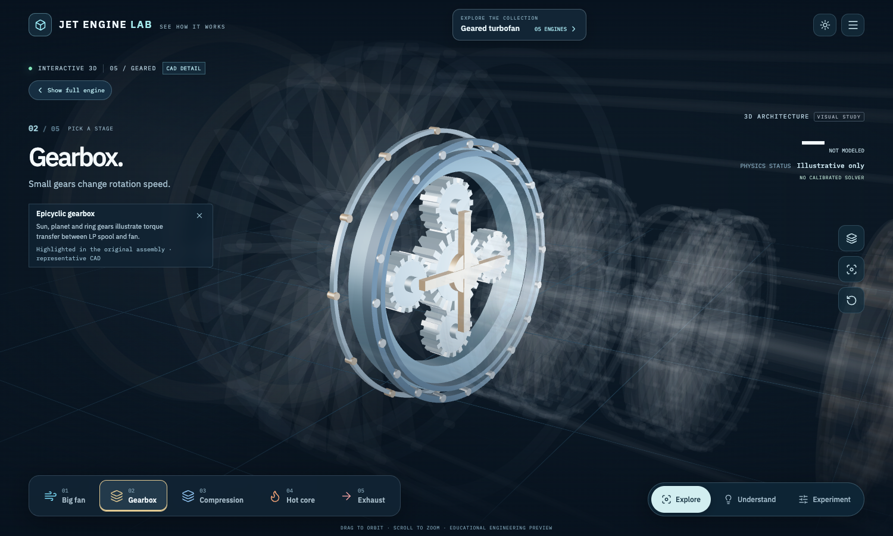 |

| Swept geared fan | Turbine guide vanes and bearing hardware | Nozzle petals and actuator linkage |
|:---:|:---:|:---:|
| 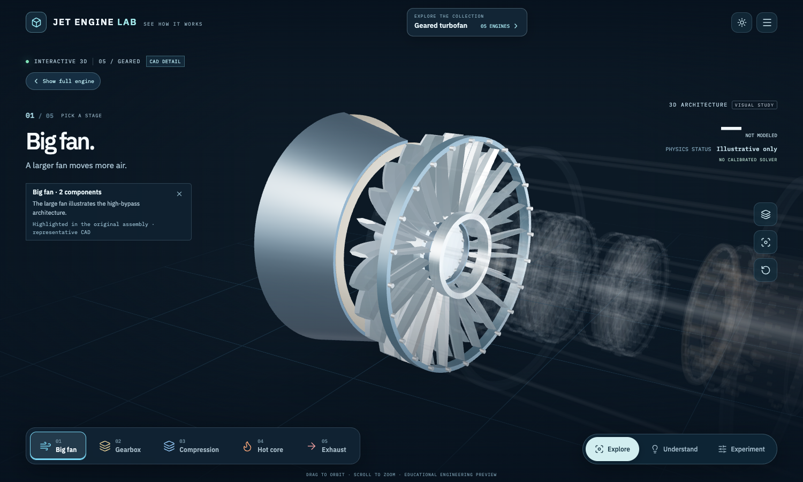 | 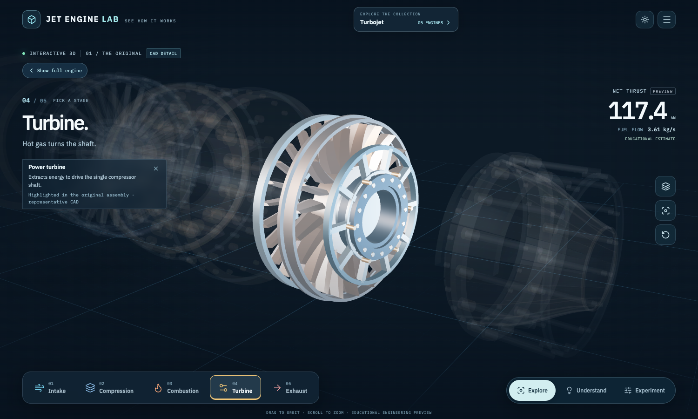 | 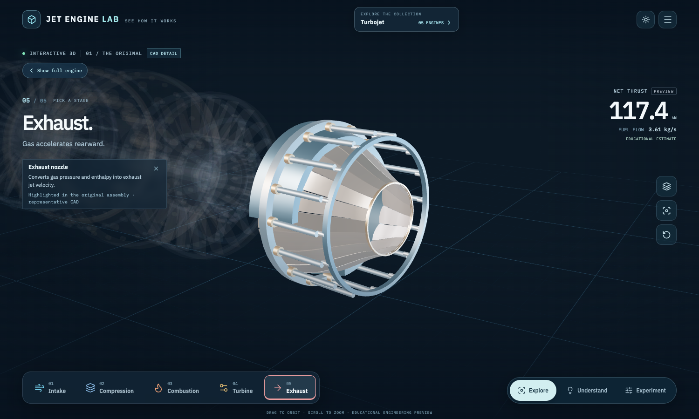 |

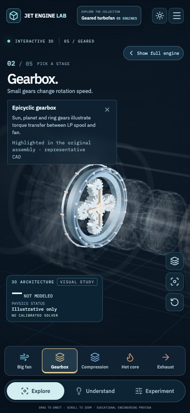

The Playwright `smoke:cad:full` verifies real HTTP 200 requests for the required source GLBs on each of the five engines and saves full-scene screenshots. The focused `smoke:cad` covers six CAD focus views and return navigation on desktop and a 390px mobile viewport. Project unit tests, TypeScript and production build must also pass before a release.
